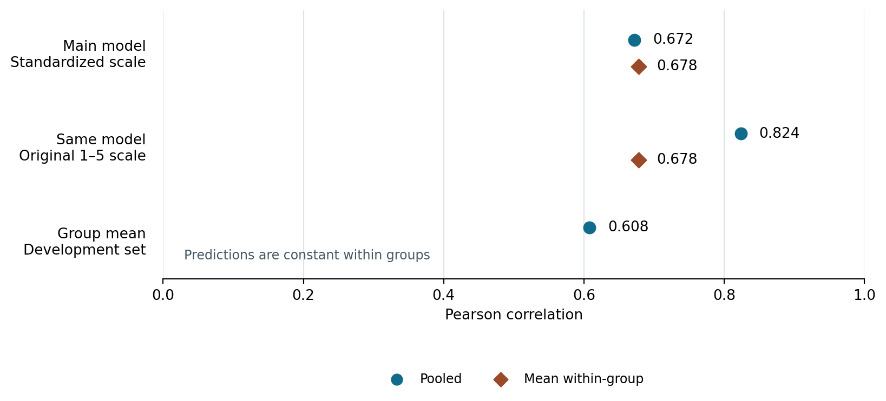
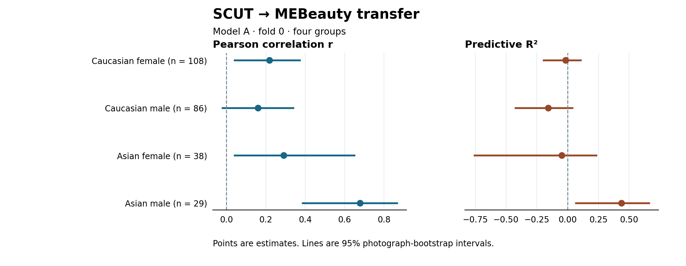

# Pooled Correlation and Within-Group Agreement in Predicting Facial Attractiveness Ratings

Matvey Kiriakov, independent researcher

## Abstract

After the final evaluation of a model for predicting attractiveness ratings, I examined how the rating scale and the groups included in the evaluation affected the assessment of its performance. On 1,196 held-out SCUT-FBP5500 photographs, expressing the same predictions and observed ratings on the original 1–5 scale changed pooled Pearson r from 0.672 to 0.824. Mean within-group r stayed at 0.678. A constant prediction set to each group's development-set mean yielded pooled r = 0.608. For a model trained on eight groups, mean within-group r was 0.680 across the original six groups and 0.585 across all eight.

When the model was transferred to MEBeauty, mean within-group r was 0.337 across four groups comprising 261 of the 492 held-out photographs. In an additional comparison against a constant forecast based on MEBeauty folds 1–4, the model had lower mean squared error in one of four groups (29 photographs), and the 95% interval for the difference excluded zero. The intervals included zero in the other three groups. Some future test photographs had appeared in early SCUT analyses, and MEBeauty fold 0 ratings were included in a descriptive audit before the final runs. Comparisons of scales, group inclusion, and errors against development-set means were post hoc.

## 1. Introduction

I started by asking which facial and photographic features are associated with attractiveness ratings. One motivation was to see which traits discussed in looksmaxxing communities could be measured from a photograph. The first model used 42 geometric measurements obtainable from a frontal image. In early SCUT-FBP5500 experiments, mean ratings varied by image source. Pooled correlation can be high in such a sample if the model picks up differences between sources. I therefore asked how well the model predicts ratings when comparisons are made among photographs from one source and one sex and population category. The prediction target is the rating of a particular photograph. Different photographs of the same person received different ratings in Experiment 4 of Jenkins et al. (2011).

After the final runs, I formulated the central question of this article. How does the assessment of model performance change with the scale and the groups included in the evaluation? Using fixed predictions, I measured the change in pooled r after restoring the original scale. I then compared the resulting pooled r with that of a baseline that uses group membership alone. SCUT groups are defined by sex, population category, and image source. I also examined sensitivity to group inclusion and the extent to which within-group agreement carried over to MEBeauty. On the second dataset, I supplemented correlation with a comparison of prediction errors against constant forecasts based on development-set means.

A simple example shows why these metrics answer different questions. Two artificial groups with different means can yield pooled r = 0.800 even when r = 0 within each group.

Liang et al. (2018) evaluated geometry-based models separately by sex and population category. DeepGeoFusion (Wang et al., 2026) compared geometric features, visual features, and their combination in such groups. Evaluation on a mixed sample also captures differences between groups. Hamel and Busch (2025) studied transfer between SCUT-FBP5500 and MEBeauty through distributions of predictions and errors. Bhangoo et al. (2026) reported errors for a SCUT-trained model separately by sex and ethnicity in MEBeauty.

## 2. Data and protocol

**Data.** SCUT-FBP5500 v2 (Liang et al., 2018) comprises 5,500 frontal 350 × 350 pixel photographs. All 60 raters, volunteers aged 18–27, rated every photograph on a scale of 1 to 5. The source does not provide a full description of the rater panel. The ratings are organized into four sheets by the dataset's sex and population labels: Asian female (AF), Asian male (AM), Caucasian female (CF), and Caucasian male (CM). The six groups analyzed contain images from the internet, DataTang, and the 10k US Adult Faces collection (see the [SCUT dataset documentation](https://github.com/HCIILAB/SCUT-FBP5500-Database-Release)). Table 1 lists the six groups. The target is the mean rater score standardized within each group to mean zero and unit standard deviation.

For external evaluation, I used the MEBeauty 2.1.0 rerelease, configuration `fbp_extended` (Lebedeva, Guo & Ying, 2022, and the dataset card). It contains 2,462 aligned 256-pixel stock portraits, five `cv_fold` partitions (0–4), and sex and ethnicity labels. Features were extracted for 2,460 portraits. The `beauty_score` target adjusts for differences in rater leniency. The dataset contains 593 raters. A descriptive audit found 8–92 ratings per portrait, with a median of 28. The histograms contain raw ratings, so reliability estimated from them refers to the unadjusted mean. This article reports aggregate results for both datasets.

| Group | Development photographs | Held out (primary / all) |
|---|---|---|
| CM 10k_US | 448 | 148 / 150 |
| AM DataTang | 1006 | 328 / 336 |
| AM internet | 488 | 145 / 162 |
| CF 10k_US | 380 | 124 / 126 |
| AF internet | 783 | 246 / 262 |
| AF DataTang | 632 | 205 / 210 |
| Total | 3737 | 1196 / 1246 |

*Table 1. The six SCUT groups. The table excludes the lab and GuangZhou sources, the CM internet and CF internet groups (38 and 61 held-out photographs), and one development photograph removed by the outlier filter (§3.1).*

**Data splits.** On 29 October, I set aside one quarter of SCUT by hashing filenames within each combination of sex, population category, and source. Early analyses of the 42 existing geometric measurements included photographs that later fell into that quarter. I saw and rated some of those photographs, and some descriptive summaries continued to include their ratings after the split. The formulas for the 42 measurements stayed the same. Additional feature blocks were developed after the split. Features were extracted from both partitions without rater scores. The association between new features and scores, and the composition of the final model, were evaluated on the development set. For MEBeauty, fold 0 (492 photographs with features) was set aside for the final evaluation. Its ratings were included in a descriptive audit on 7 November. The models were trained without fold 0.

**What was recorded before the final runs.** I recorded the final model and decision criteria in an internal Git log without an independent timestamp. On 11 November, I ran the final evaluation once on each held-out partition. Comparisons of scales and group inclusion, as well as additional checks of MEBeauty prediction error and the contribution of SCUT training data, followed those runs. See the [timeline of data access and decisions](supplement_en.md#appendix-c-data-access-and-protocol-history).

## 3. Methods

### 3.1 Features

Features are computed from a single frontal photograph without using ratings. Forty-two geometric measurements (distance ratios and angles) were derived from facial landmarks identified by MediaPipe Face Landmarker (478 points). An additional 28 detail features used landmarks and pixels. They cover contrast, facial contour, chin and lip tone, eyebrows, eyes and eyelids, the nose tip, and the jaw and chin. Appendix B defines all 70 features.

Seven other quantities were used for partial correlations (Appendix G) and variance partitioning by feature block (Appendix D). They were excluded from the main model. Six capture measures were face fraction, sharpness, brightness, contrast, face size in pixels, and bytes per pixel. The seventh was apparent age from the InsightFace genderage model applied to a face crop.

Feature values were winsorized at the first and 99th percentiles of the group's development data and standardized using its mean and standard deviation. Missing values were imputed with development-set medians. A photograph was excluded if any of the 42 geometric measurements differed from the median by more than 50 interquartile ranges. For this filter, development medians and interquartile ranges were calculated separately for AF, AM, CF, and CM. Photographs with failed landmark detection were also excluded. The outlier rule removed one development photograph. The filters did not screen for glasses, beards, children, or makeup.

### 3.2 Target, groups, and models

The target is the mean of all 60 ratings (1–5), standardized within each group using development-set statistics. Each rater scored every photograph. The mean is the reference for agreement with this panel. Individual preferences can differ from the panel mean (Hönekopp, 2006).

The main model was gradient boosting with fixed settings (Appendix E), fitted once to 3,737 development photographs from all six groups. I also evaluated ridge regression. The geometry-only variants used the same algorithms on 42 measurements. For a sensitivity check, I fitted a separate boosting model using 70 features, six group indicators, and the original-scale target. It appears in an additional row of Table 3.

Before each final run, the script checked hashes of the inputs and library versions and set a marker that blocks a routine repeat run. Results were written to a file.

### 3.3 Performance measures and benchmarks

I calculated Pearson correlation between predictions and standardized ratings within each group. The 95% intervals use 1,000 bootstrap resamples of photographs. I also report predictive R², which can be negative when a constant mean forecast has lower squared error. The recorded 0.40–0.70 band was for the geometry-only model. Expectations for the main model used development results minus 0.03–0.04, with a tolerance of ±0.08.

| Measure | Question | Interpretation |
|---|---|---|
| Pooled correlation (pooled r) | How closely do predictions and ratings agree in this mix of photographs? | Reflects both within-group associations and differences between group levels. |
| Mean within-group correlation (macro r) | How much agreement is there within the selected groups on average? | Groups receive equal weight regardless of size. |
| Predictive R² | How does squared error compare with a constant forecast of the evaluation mean? | Depends on calibration and prediction scale and can be negative. |

### 3.4 Scale, groups, and pooled correlation

**Fixed SCUT predictions.** To evaluate on the original scale, I multiplied each main-model prediction by the standard deviation of mean rater scores in the corresponding development group and added the group's development mean. I restored the observed ratings using the same transformation. On each scale I calculated pooled r and the equally weighted mean of the six within-group correlations. A forecast based solely on group membership uses the group's development mean. To estimate uncertainty for pooled r minus macro r, I used 5,000 paired bootstrap resamples of photographs within groups.

On the original scale, pooled r can reflect agreement between group levels and depends on their spread. Rescaling by a positive factor and adding a constant within a group preserves its r. Subtracting the group-only correlation from the model's pooled correlation does not recover within-group performance. The [formula and transformation steps](#scale-and-covariance) are in Appendix E.

**Sensitivity to group inclusion.** After the final run, I added CM internet and CF internet to the development sample, refitted boosting with the same 70 features and settings, and applied the original ArcFace criterion relative to the expanded development sample. First I compared the two models on the same photographs from six groups. I then recalculated the mean within-group r of the eight-group model over all eight groups. Both intervals use 5,000 paired bootstrap resamples of photographs within groups.

### 3.5 Transfer to another dataset

Model A was trained on SCUT only. When applied to MEBeauty fold 0, its inputs were standardized within groups using feature statistics from MEBeauty folds 1–4. For the original fold 0 evaluation, the target was standardized within groups using all five folds. This leaves within-group correlations unchanged but sets the scale used for R². Within each sex-by-ethnicity group, I calculated Pearson correlation with `beauty_score` (with a photograph bootstrap), Spearman correlation, and R².

I confirmed both criteria on 7 November, before the exploratory run on folds 1–4. Before the final run, I recorded that judgments would use the boosting version of Model A. The average criterion (`useful` in the protocol) required mean r of at least 0.30 across the four specified groups. The all-groups criterion (`transfers`) required a lower interval bound above zero in every group. If an interval included zero, the group was classed as inconclusive if its upper bound reached 0.30, and as failing the criterion otherwise.

The same script also evaluated the following:

- Pooled correlation over 261 photographs from the four groups after centering predictions within groups, with a lower interval bound above zero as the criterion.
- Model B, trained jointly on SCUT and MEBeauty folds 1–4 (1,968 photographs, or 2,460 with features including fold 0). The criterion for benefit from adding MEBeauty data was an improvement of at least 0.03 with a lower interval bound above zero.
- Results after excluding quality-flagged photographs. Flags covered head tilt and rotation, open mouth, missing hairline detection, and feature outliers. They flagged 139 of 492 images and did not screen for glasses, beards, children, or heavy makeup.
- Partial correlation adjusting for model-estimated age.

The exploratory transfer evaluation used folds 1–4. Fold 0 ratings appeared in the descriptive audit of distributions and splits on 7 November. Final model training excluded fold 0. The final evaluation on that fold took place on 11 November.

After the final run I added Model C, trained only on MEBeauty folds 1–4 with the same 70 features, settings, and preprocessing as Model B. All three models were compared on the same fold 0 photographs and target scale. I compared Model A's error with that of predicting the evaluation-group mean, which is also the reference used in the denominator of R². New comparisons used 5,000 paired bootstrap resamples of photographs within groups. The evaluation-group mean was recalculated in each resample. The prespecified measures from the final B script used 1,000 replicates.

In a further analysis on 20 November, I took the saved Model A predictions and defined the target scale using the mean and standard deviation of ratings within each group of MEBeauty folds 1–4, restricted to photographs with features. On that scale, a prediction of zero corresponds to the folds 1–4 group mean. I compared squared errors of the model and the zero forecast on fold 0. The scale and constant forecast were held fixed during 5,000 paired bootstrap resamples of photographs within each group. Applying this procedure to new photographs requires development ratings from MEBeauty and a group label.

## 4. Results

### 4.1 Within-group agreement

The 70-feature model achieved mean within-group r = 0.678 across six groups. The 42 geometry features alone yielded 0.643. The mean increase with the additional features was 0.035, with no separate uncertainty estimate for that difference. It was larger in CF 10k_US and AF DataTang than in the two AM groups. Predictive R² ranged from 0.331 to 0.648 relative to the corresponding evaluation-group mean.

| Group | n | r, 70 features [95%] | R² | Geometry r | r, all photographs |
|---|---|---|---|---|---|
| CM 10k_US | 148 | 0.576 [0.449, 0.686] | 0.331 | 0.549 | 0.581 |
| AM DataTang | 328 | 0.620 [0.553, 0.681] | 0.374 | 0.618 | 0.619 |
| AM internet | 145 | 0.809 [0.747, 0.859] | 0.648 | 0.798 | 0.765 |
| CF 10k_US | 124 | 0.671 [0.571, 0.759] | 0.427 | 0.590 | 0.670 |
| AF internet | 246 | 0.685 [0.588, 0.762] | 0.465 | 0.653 | 0.688 |
| AF DataTang | 205 | 0.707 [0.637, 0.765] | 0.496 | 0.649 | 0.694 |
| Mean | | 0.678 | | 0.643 | 0.670 |

*Table 2. Pearson correlation with the mean rater score within groups. Results with and without the similarity filter come from the same final run.*

The model was fitted to 3,737 photographs and evaluated on 1,196 held-out photographs. The primary analysis excluded 50 photographs with a maximum ArcFace embedding cosine similarity to the development set above 0.60. I used the buffalo_l package with 512-dimensional embeddings. With all photographs included, macro r was 0.670. The largest change occurred in AM internet, where r fell from 0.809 to 0.765.

CM internet and CF internet had the weakest preliminary results. On the day of the run, I omitted them from training and reporting based on a threshold of 200 development photographs drawn from exploratory work. The model's superiority over a single rater was not established in any of the six groups. The comparison with raters, the tests by sex and population category, and the looksmaxxing claims are in [Appendix G](supplement_en.md#appendix-g-additional-checks).

### 4.2 What changes pooled correlation on the same photographs?

| Setup on 1,196 photographs | Pooled r | Mean r, six groups | Pooled minus mean r [95%] |
|---|---:|---:|---:|
| Main model, standardized scale | 0.672 | 0.678 | −0.006 [−0.019, 0.010] |
| Same model, original 1–5 scale | 0.824 | 0.678 | +0.146 [0.118, 0.177] |
| Separate model with group indicators, 1–5 scale | 0.823 | 0.677 | +0.147 [0.120, 0.178] |
| Development-group mean, 1–5 scale | 0.608 | Undefined | — |

*Table 3. Post hoc comparisons. Within-group correlation for the group-mean forecast is undefined because predictions are constant within each group. Intervals describe variation across photographs with predictions held fixed.*

*Figure 1. The first two rows use predictions from the same model on the same photographs. Restoring the 1–5 scale uses only development-group means and standard deviations. The last row predicts the development mean of each group. Points are estimates, and Table 3 gives intervals for the differences.*

On the standardized scale, pooled and mean within-group r are close. Restoring the original scale preserves mean within-group r but increases pooled r. The diagnostic sequence on the same predictions was 0.672 on the standardized scale, 0.674 after centering predictions and ratings within the test groups, 0.700 after restoring group standard deviations, and 0.824 on the original scale. Restoring the group levels produced the largest change in this sequence. The separate model with group indicators yielded a similar result.

### 4.3 Including two small SCUT groups

Reapplying the ArcFace similarity filter against the expanded development set excluded one additional photograph from CM 10k_US. On the 1,195 photographs common to both evaluations, expanding training from six to eight groups changed macro r from 0.677 to 0.680 (difference +0.003 [−0.005, 0.011]). Including the two additional groups in reporting decreased macro r for the same model from 0.680 to 0.585 (difference −0.095 [−0.147, −0.045]). CM internet had r = 0.227 [−0.124, 0.573] on 33 photographs, and CF internet had r = 0.369 [0.165, 0.558] on 57. The 0.678 from the final run therefore describes the specified six groups. See the [full eight-group calculation](review_sensitivity.md).

### 4.4 Transfer to MEBeauty

| MEBeauty group | n | Model A Pearson r, final [95%] | A Spearman | A R² | A minus test-mean MSE, post hoc [95%] |
|---|---:|---:|---:|---:|---:|
| caucasian female | 108 | 0.218 [0.034, 0.379] | 0.167 | −0.018 | +0.017 [−0.114, 0.168] |
| caucasian male | 86 | 0.160 [−0.022, 0.345] | 0.186 | −0.158 | +0.130 [−0.035, 0.343] |
| asian female | 38 | 0.290 [0.036, 0.665] | 0.407 | −0.047 | +0.048 [−0.283, 0.531] |
| asian male | 29 | 0.678 [0.381, 0.868] | 0.721 | +0.436 | −0.347 [−0.610, −0.035] |
| Group mean | 261 total | 0.337 | — | +0.053 | — |

*Table 4. Model A was trained on SCUT. The error benchmark predicts the mean rating of the test group itself. A positive error difference indicates higher error for Model A. The correlation intervals from the final run use 1,000 resamples. The post hoc error intervals use 5,000. The averages weight each group equally.*

On fold 0, mean r passed the recorded threshold of 0.30 by its point estimate. The post hoc interval for this mean encompasses the threshold [0.227, 0.454]. The requirement that every group have a lower bound above zero was not met. Pooled r over 261 photographs after centering predictions within groups was 0.263 [0.156, 0.366]. Excluding the group of 29 photographs, the other three groups averaged r = 0.223 and R² = −0.074. In each of the three groups with negative R² point estimates, the interval for the error difference relative to the evaluation-group mean included zero.

*Figure 2. Model A on fold 0 in the four primary groups. Both panels show intervals from the same post hoc paired bootstrap with 5,000 resamples. Correlation intervals in Table 4 come from the original run.*

Adding MEBeauty training data (Model B) increased mean r on fold 0 from 0.337 to 0.431. The improvement of 0.094 [0.034, 0.146] in the final run met the recorded criterion. In a post hoc comparison on the same photographs, MEBeauty-only Model C reached mean r = 0.473. The paired difference for C minus A was +0.136 [0.010, 0.228]. For B minus C it was −0.042 [−0.107, 0.045], allowing an advantage in either direction.

Using the scale and constant forecast fixed from MEBeauty folds 1–4, the error differences were as follows (MSE of Model A minus MSE of the constant forecast).

| MEBeauty group | n | MSE difference [95%] |
|---|---:|---:|
| caucasian female | 108 | +0.018 [−0.127, 0.160] |
| caucasian male | 86 | +0.133 [−0.044, 0.326] |
| asian female | 38 | +0.050 [−0.319, 0.502] |
| asian male | 29 | −0.351 [−0.651, −0.071] |

*Table 5. Post hoc rescoring of fold 0. Both the scale and the constant forecast were fixed using MEBeauty development folds 1–4. A negative difference favors Model A. In three groups, the intervals allow an advantage for either forecast. In the group of 29 photographs, the interval lies entirely below zero.*

## 5. Discussion

The SCUT model learned to predict departures from a photograph's group mean. The inverse transformation adds information about group levels from the development set and requires sex, population category, and image-source labels. In this setting, the same model achieves pooled r = 0.824 and macro r = 0.678. The law of total covariance explains how this can happen. The fixed-prediction comparison measures the size of the change in this particular evaluation. A similar question arises when studies report a single Pearson correlation over a mixed test set, as in the cross-domain FPEM evaluation (Li et al., 2025). A numerical comparison would require a common sample, scale, and grouping rules.

On MEBeauty, positive correlation alone did not ensure lower error than a constant forecast based on development-group means. Transfer evaluation depends on what information from the target dataset is already available. Model A's input standardization used MEBeauty photographs from folds 1–4, and the development-based error scale also used their ratings. The comparison between B and C shows that the benefit of including SCUT remains uncertain when labeled MEBeauty training data are available.

### Repeating the checks on another dataset

1. Define groups according to the intended application, report their sizes, and specify inclusion rules before evaluating the test predictions. If some small groups are excluded, show how their inclusion changes the summary.
2. Save predictions and report pooled r on the chosen scale, r for each group, and an average with explicit weights. If the scale is restored separately by group, rerun the evaluation before and after the transformation on the same photographs.
3. On the same photographs, evaluate a constant forecast based on development-group means. If numerical ratings are important, report the model's error minus that of the constant forecast with a paired interval.
4. In transfer experiments, state whether target-domain features or ratings were used for standardization, calibration, or training. When target ratings are available, compare joint training with training only on the target dataset.

### Limitations

Some future SCUT test photographs appeared in early analyses, and the decision about the two small groups followed a review of development results. MEBeauty fold 0 appeared in the descriptive audit and was reused after the final run. The size of any bias from early access was not estimated. For SCUT group composition, a separate sensitivity check showed that including the two small groups decreased macro r by 0.095 with the model held fixed (§4.3). The intervals describe variation across photographs conditional on the models and groups. The MEBeauty result covers four groups comprising 261 of the 492 evaluation photographs. Understanding how capture conditions and the rater panel affect the transferability of this protocol requires separate data.

## 6. Conclusion

On 1,196 SCUT photographs, restoring the same predictions and observations to the 1–5 scale changed pooled r from 0.672 to 0.824 while macro r stayed at 0.678. The spread of each group contributed differently on the restored scale, and agreement between group levels entered the pooled result. A constant forecast using each group's development mean yielded pooled r = 0.608 while assigning all photographs in a group the same score.

On MEBeauty, transferred predictions achieved mean within-group r = 0.337. In a post hoc analysis, the model had lower squared error than a forecast using the folds 1–4 group mean in one of four groups (29 photographs), with an interval excluding zero. Intervals included zero in the other three groups.

The work on 42 geometric measurements suggests a more practical question for a follow-up. Can a fixed model predict which of two photographs of the same person an independent panel will rate higher? Jenkins et al. (2011, Experiment 4) found that ratings differed across photographs of the same person. Such a study could control capture conditions, compare predicted and observed differences for each person, and benchmark them against the repeatability of the panel's ratings. This would test whether agreement across people carries over to choosing between photographs of one person.

## Declarations

**Funding.** This study received no funding.

**Competing interests.** The author declares no competing interests.

**Data availability.** This is a secondary analysis of SCUT-FBP5500 and MEBeauty. The accompanying materials contain aggregate results and a synthetic example. The datasets are available from their respective providers under their own terms.

**Ethics and data handling.** The study used existing photographs and ratings from two datasets. No participants were recruited for this study. Public materials contain aggregate results and a synthetic example. The dataset providers describe their access conditions.

**Author contributions (CRediT).** Matvey Kiriakov: Conceptualization, Methodology, Investigation, Writing – review & editing.

**Code availability.** Analysis code and the protocol record are held in a local Git repository. The protocol has no independent external timestamp. The accompanying materials include code to reproduce the synthetic example and selected analysis scripts.

**Use of AI.** Claude (Anthropic) and OpenAI Codex were used to prepare and review code, discuss calculations, work with the literature, edit the manuscript, and provide trial reviews. The author set the research questions, made design decisions, and takes responsibility for the conclusions. For the looksmaxxing claims, the author contributed topics and approved the list, and an AI assistant proposed particular measures and expectations.

## Appendices

[Appendices A–D and G](supplement_en.md) cover decision history, feature definitions, comparisons with recorded expectations, and further results. [Appendix F](importance_en.md) reports grouped feature importance. Appendix E gives technical details. Aggregate [diagnostics](evaluation_diagnostics.md) and [SCUT checks](scut_editorial_checks.json) accompany the article, as does the [sensitivity report](review_sensitivity.md). See the [reference list](references_en.md) for sources.

### Appendix E. Technical details

- Boosting used HistGradientBoosting with learning rate 0.06, 200 iterations, depth 3, at least 20 photographs per leaf, L2 = 1.0, and random_state = 0. Ridge used median imputation, standardization, and alpha = 10.
- Split: SHA-1 hash of the string “20261029:” followed by the filename. A quarter of the photographs from each group and source were set aside.
- The final scripts verified SHA-256 hashes for 24 inputs and library versions. A NumPy warning in the rater bootstrap occurred when a rater's scores were constant in a resample. Recalculating both correlations with the same valid raters preserved all interval bounds to the reported precision.
- The 50-interquartile-range rule removed one development photograph from AF internet. The exploratory check on 12 November included it and therefore covered 784 photographs in that group instead of 783.
- The protocol (v1.1, item 3) describes the exclusion rule as applying to “any of the 70 features”. It was applied to the 42 geometry features.
- The decision about the small CM internet and CF internet groups was taken on the day of the run (v1.4, item 7). Under v1.1, small groups were to be reported without a verdict.
- The distinction between inconclusive and failing to meet the MEBeauty criterion dates to v1.4.
- In the development set, absolute Spearman correlations were 0.82 between cheekbone-to-jaw ratio and jaw width, 0.71 between jaw angle and jaw width, and 0.64 between jaw angle and oval compactness. Omitting the jaw component from M_core changed signed Spearman correlation for “masculine faces in men” from −0.140 to −0.055 and for “feminine faces in women” from +0.259 to +0.153 (exploratory, `results/2026-11-12_cheap_checks_dev.txt`).
- Result sources include `S_lockbox_run.txt`, `mebeauty_B_run.txt`, `posthoc_ladder_lockbox.txt`, `posthoc_ladder_ci.txt`, `2026-10-30_raw_target_kfold.txt`, and `2026-11-12_cheap_checks_dev.txt`.

#### Scale and covariance

To trace the change in pooled r, I first subtracted each evaluation-group mean from predictions and observations separately on the standardized scale. I then multiplied each set of residuals by the corresponding development-group standard deviation. The last step restores group levels on the original scale. Centering uses test means only to describe fixed predictions. The contribution of each step depends on the order of transformations.

For group G, the law of total covariance gives

$$
\operatorname{Cov}(Y,\widehat Y) =
\operatorname{E}[\operatorname{Cov}(Y,\widehat Y\mid G)]
+ \operatorname{Cov}(\operatorname{E}[Y\mid G],\operatorname{E}[\widehat Y\mid G]).
$$

Here Y is the observed rating and Ŷ the prediction. The first term averages within-group covariances weighted by group proportions. The second captures how the group means vary together. Pooled r divides the sum by the product of the overall standard deviations. Macro r uses group-specific standard deviations in each correlation and weights those correlations equally. The group-only forecast is a reference point. Subtracting its pooled r from the model's pooled r does not isolate within-group performance.

**Eight-observation example.** In each of two groups, the observed values add residuals (−1, −1, 1, 1) to the group center and the predictions add residuals (−1, 1, −1, 1). With centers −2 and +2, pooled r = 0.800 and r = 0 within both groups. Predicting the group center yields pooled r = 0.894. The [dependency-free script](group_correlation_demo.py) reproduces the example and accepts a reader's own table.
