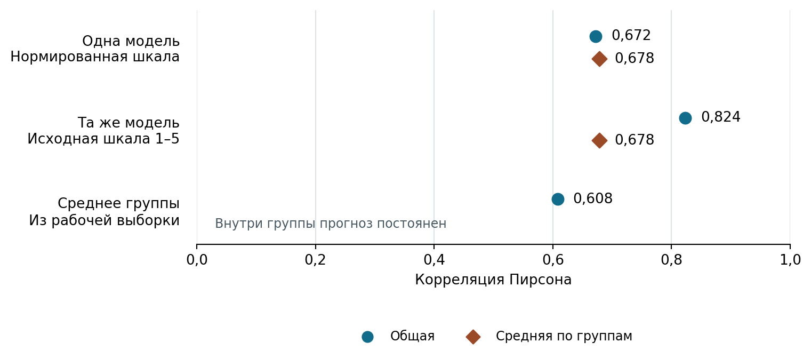
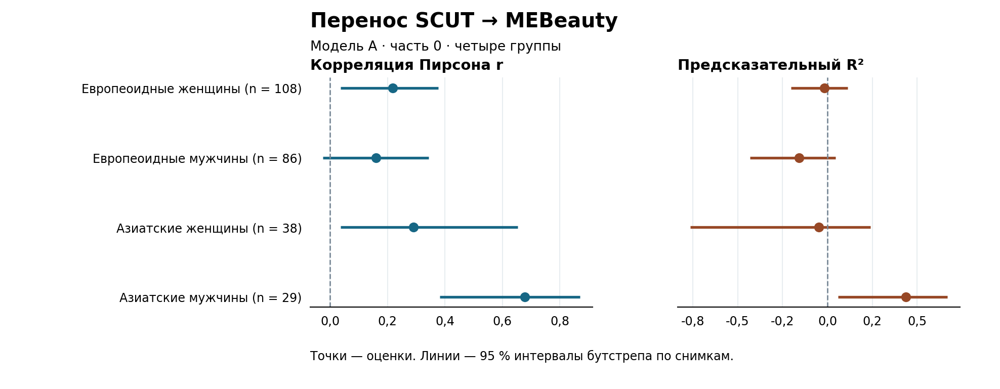

# Общая корреляция и согласие внутри групп при прогнозе оценок привлекательности

Matvey Kiriakov, независимый исследователь

## Аннотация

После итоговой проверки модели оценок привлекательности я исследовал, как шкала и состав групп влияют на оценку её качества. На 1 196 отложенных снимках SCUT-FBP5500 перевод тех же прогнозов и оценок на шкалу 1–5 изменил общую корреляцию Пирсона с 0,672 до 0,824. Среднее внутригрупповое r осталось 0,678. Прогноз по среднему рабочей выборки группы дал общий r = 0,608. У модели, обученной на восьми группах, среднее внутригрупповое r составило 0,680 для исходных шести групп и 0,585 для всех восьми.

При переносе на MEBeauty среднее внутригрупповое r составило 0,337 на 261 из 492 отложенных снимков (четыре группы). В дополнительном сравнении с прогнозом по средним частей 1–4 MEBeauty квадратичная ошибка модели была ниже в одной из четырёх групп (29 снимков), и 95 % интервал разности не включал ноль. В остальных трёх группах интервалы включали ноль. До итоговых прогонов часть будущего теста участвовала в ранних анализах SCUT, а оценки части 0 MEBeauty вошли в описательный аудит. Сравнения шкал, состава групп и ошибок относительно рабочих средних выполнены постфактум.

## 1. Введение

Я начал с вопроса о том, какие признаки лица и снимка связаны с оценками привлекательности. В числе исходных вопросов было и то, какие признаки, обсуждаемые в среде луксмаксинга, можно измерить по фотографии. Первой моделью были 42 пропорции, которые можно измерить на фронтальном снимке. В первых опытах на SCUT-FBP5500 средние оценки фотографий из разных источников различались. Общая корреляция в такой выборке может быть высокой, если модель улавливает различия между источниками. Поэтому я проверил, насколько хорошо она предсказывает оценки, когда сравниваются снимки людей одного пола и одной популяции из одного источника. Объект прогноза здесь — оценка конкретного снимка. В эксперименте 4 Jenkins et al. (2011) разные фотографии одного человека получали разные оценки.

После итоговых прогонов я сформулировал центральный вопрос этой статьи: как на одних и тех же снимках меняется вывод о качестве модели при смене шкалы и состава групп? Я проверил на одних и тех же прогнозах, насколько общий r меняется при возврате к исходной шкале и как он соотносится с корреляцией по одной метке группы. Группу на SCUT определяют пол, популяция и источник снимка. Затем я проверил, насколько вывод зависит от включённых групп и что остаётся от внутригруппового согласия при переносе на MEBeauty. На втором наборе я дополнил корреляцию сравнением ошибок модели и постоянного прогноза по средним рабочей выборки.

Простой пример показывает, зачем различать эти метрики. У двух искусственных групп с разными средними общий r равен 0,800, хотя внутри каждой группы r = 0.

Liang et al. (2018) оценивали геометрические модели отдельно по полу и популяции. Wang et al. (2026) в работе DeepGeoFusion сравнили в таких группах геометрические признаки, визуальные признаки и их сочетания. При общей оценке по смешанной выборке корреляция учитывает также различия между группами. Перенос между SCUT-FBP5500 и MEBeauty исследовали Hamel и Busch (2025) по распределению прогнозов и ошибок. Bhangoo et al. (2026) сообщили ошибки модели, обученной на SCUT, для отдельных групп MEBeauty по полу и этничности.

## 2. Данные и протокол

**Данные.** SCUT-FBP5500 v2 (Liang et al. 2018): 5500 фронтальных лиц 350 × 350 пикселей. Каждое лицо оценили все 60 судей, волонтёры 18–27 лет, по шкале от 1 до 5. Полные характеристики панели в источнике не приведены. Лица разделены на четыре листа по полу и популяции: азиатские женщины (AF) и мужчины (AM), европеоидные женщины (CF) и мужчины (CM). В шести анализируемых группах представлены фотографии из интернета, DataTang и коллекции 10k US Adult Faces (см. [описание SCUT авторами набора](https://github.com/HCIILAB/SCUT-FBP5500-Database-Release)). Анализируются шесть групп: CM 10k_US, AM DataTang, AM internet, CF 10k_US, AF internet, AF DataTang (таблица 1). Цель — средняя оценка судей, нормированная внутри группы (среднее 0, разброс 1).

Для внешней проверки использован перевыпуск MEBeauty 2.1.0, конфигурация `fbp_extended` (Lebedeva, Guo & Ying, 2022, и карточка перевыпуска). В нём 2462 выровненных стоковых портрета размером 256 пикселей, пять частей `cv_fold` (0–4) и метки пола и этничности. Признаки вычислены для 2460 портретов. Цель `beauty_score` учитывает различия в строгости оценщиков. В наборе 593 оценщика. По описательному аудиту на портрет приходится 8–92 оценки с медианой 28. Гистограммы содержат сырые оценки, поэтому расчёт надёжности по ним относится к обычному среднему. Результаты обоих наборов приведены в агрегированном виде.

| группа | лиц в рабочей выборке | отложенных лиц (основной расчёт / со всеми) |
|---|---|---|
| CM 10k_US | 448 | 148 / 150 |
| AM DataTang | 1006 | 328 / 336 |
| AM internet | 488 | 145 / 162 |
| CF 10k_US | 380 | 124 / 126 |
| AF internet | 783 | 246 / 262 |
| AF DataTang | 632 | 205 / 210 |
| всего | 3737 | 1196 / 1246 |

*Таблица 1. Шесть групп. Вне таблицы остались источники lab и GuangZhou, группы CM internet (38 отложенных лиц) и CF internet (61) и снимок рабочей выборки, удалённый фильтром выбросов (§3.1).*

**Как разделены данные.** 29 октября я отложил четверть SCUT по хешу имени файла внутри каждой группы и источника. В ранних прогонах 42 уже существовавших пропорций участвовали лица, которые впоследствии попали в эту четверть. Часть этих снимков я видел и оценивал, а отдельные описательные сводки включали их оценки и после разбиения. Формулы 42 пропорций сохранились. Дополнительные блоки появились после разбиения. Признаки вычислялись по снимкам обеих частей без оценок судей, а связь новых признаков с оценками и состав итоговой модели проверялись на рабочей выборке. В MEBeauty для итоговой проверки выделена часть 0 (492 снимка с признаками). Оценки этой части вошли в описательный аудит 7 ноября. Модели обучались без неё.

**Что было записано заранее.** Итоговую модель и критерии я записал во внутреннем журнале Git без внешней отметки времени. 11 ноября я выполнил по одному итоговому прогону на отложенных частях SCUT и MEBeauty. Сравнение шкал, расширение набора групп и дополнительные проверки ошибки и вклада SCUT на MEBeauty я выполнил после этих прогонов. [Хронология доступа и решений](appendices_ru.md#приложение-в-хронология-доступа-к-данным-и-записи-протокола).

## 3. Методы

### 3.1 Признаки

Признаки считаются по одной фронтальной фотографии, без участия оценок. По ориентирам лица (MediaPipe Face Landmarker, 478 точек) получено 42 геометрических пропорции (отношения расстояний и углы). К ним добавлены 28 признаков деталей, считаемых по ориентирам и пикселям, в семи группах: контраст, контур лица, тон подбородка и губ, брови, глаза и веки, кончик носа, челюсть и подбородок. Вместе это 70 признаков, определения в приложении Б.

Ещё семь величин в основную модель не входят и используются для частных корреляций (приложение Ж) и разложения по блокам (приложение Г): шесть показателей съёмки (доля лица в кадре, резкость, яркость, контраст, размер лица в пикселях, байт на пиксель) и возраст по нейросети — число, которое выдаёт сеть InsightFace genderage по вырезанной области лица; это не настоящий возраст человека.

Значения обрезаются по 1-му и 99-му перцентилям рабочей выборки группы и нормируются по её среднему и стандартному отклонению; статистики отложенных лиц не используются. Пропуски заменяются медианой рабочей выборки. Снимок исключался, если хотя бы одна из 42 пропорций отстояла от медианы больше чем на 50 межквартильных размахов. Для этого фильтра медиану и размах считали по рабочей выборке отдельно для AF, AM, CF и CM. Снимки со сбоем детекции ориентиров также исключались. Правило исключило одно лицо рабочей выборки. Фильтры не проверяют очки, бороды, детей и косметику.

### 3.2 Цель, группы, модели

Цель — средняя оценка 60 судей (шкала 1–5), нормированная внутри группы по статистикам рабочей выборки. Каждый судья оценил каждый снимок. Среднее служит ориентиром для согласия с этой панелью. Индивидуальные предпочтения могут отличаться от её средней оценки (Hönekopp, 2006).

Основная модель — градиентный бустинг с фиксированными настройками (приложение Д), обученный один раз на 3737 лицах рабочей выборки шести групп вместе. Вторая модель — ridge-регрессия. Модель на одних пропорциях — те же алгоритмы на 42 пропорциях. Для проверки чувствительности я также обучил бустинг на 70 признаках и шести индикаторах групп с целью на исходной шкале. Эта модель используется в дополнительной строке таблицы 3.

Перед прогоном программа проверяла неизменность входных файлов и версий библиотек и выставляла отметку, блокирующую штатный повторный запуск. Числа записывались в файл результата.

### 3.3 Как измерялась точность и с чем она сравнивалась

**Точность.** Корреляция Пирсона между предсказанием и нормированной оценкой внутри каждой группы; 95 % интервал получен многократной повторной выборкой лиц (бутстреп, 1000 повторов). Рядом посчитан предсказательный R²; он может быть отрицательным, если предсказание хуже, чем постоянное среднее. Заранее записанная полоса 0,40–0,70 относилась к пропорциям; ожидание для основной модели записано по числам рабочей выборки (рабочая минус 0,03–0,04) с коридором ±0,08.

| Мера | На какой вопрос отвечает | Как читать результат |
|---|---|---|
| Общая корреляция (pooled r) | Насколько согласуются предсказания и оценки в данной смеси снимков? | Учитывает связи внутри групп и различия между их уровнями. |
| Среднее внутригрупповых корреляций (macro r) | Каково среднее согласие внутри выбранных групп? | Группы разного размера получают одинаковый вес. |
| Предсказательный R² | Насколько квадратичная ошибка отличается от ошибки постоянного прогноза средним на проверочной выборке? | На результат влияют калибровка и шкала предсказания. Возможны отрицательные значения. |

### 3.4 Шкала, группы и общая корреляция

**Фиксированные прогнозы SCUT.** Для оценки на исходной шкале я умножал прогноз основной модели на стандартное отклонение средних оценок судей в соответствующей группе рабочей выборки и прибавлял среднее этой группы. Шкалу наблюдаемых оценок восстанавливал тем же способом. Для каждой шкалы я считал общий r по снимкам и среднее шести внутригрупповых r с равными весами. Прогноз, основанный только на метке группы, равен её среднему в рабочей выборке. Для разности общего и среднего внутригруппового r я использовал 5 000 парных бутстреп-повторов со случайной выборкой снимков внутри групп.

На исходной шкале общий r учитывает совместные различия уровней групп и зависит от их разброса. Положительное линейное преобразование внутри группы сохраняет её r. Вычитание корреляции прогноза по метке группы из общей корреляции модели не даёт внутригрупповую точность. Формула и шаги преобразования приведены в [приложении Д](#шкала-и-ковариация).

**Чувствительность к выбору групп.** После итогового прогона я добавил CM internet и CF internet в рабочую выборку, заново обучил бустинг с теми же 70 признаками и настройками, а исходное правило ArcFace применил относительно расширенной рабочей выборки. Сначала сравнил обе модели на одних и тех же снимках шести групп. Затем для модели, обученной на восьми группах, пересчитал среднее r по всем восьми. Для обеих разностей интервалы рассчитаны парным бутстрепом по снимкам внутри групп (5 000 повторов).

### 3.5 Как проверялся перенос на другой датасет

Модель A обучена только на SCUT. При применении к части 0 MEBeauty признаки внутри каждой группы нормируются по статистикам признаков MEBeauty из частей 1–4. Для оценки на части 0 целевая переменная стандартизирована внутри группы по всем частям. Такая стандартизация не меняет корреляции внутри группы, но задаёт шкалу для R². Для каждой группы «пол × этничность» считаются корреляция Пирсона с beauty_score (бутстреп по лицам), корреляция Спирмена и R².

Оба критерия я подтвердил 7 ноября, до поискового прогона на частях 1–4. Перед итоговым прогоном было записано, что вердикты определяет бустинг модели A. Критерий «в среднем» (в протоколе `useful`) — среднее r по четырём записанным группам не ниже 0,30; «во всех группах» («transfers») — нижняя граница интервала выше нуля в каждой из четырёх. Если интервал группы включает ноль, группа считается «не решена» при верхней границе не ниже 0,30, иначе «не выполнено».

Дополнительные расчёты тем же скриптом:

- корреляция по 261 лицу четырёх групп вместе после центрирования предсказаний внутри групп. Критерий — нижняя граница интервала выше нуля;
- обучение модели B на SCUT вместе с лицами частей 1–4 MEBeauty (1968 лиц; вместе с частью 0 всего 2460 лиц с признаками) и критерий «добавление данных MEBeauty помогает» (прирост не меньше 0,03 с нижней границей выше нуля);
- результат без лиц с флагами качества (наклон и поворот головы, раскрытие рта, отсутствие найденной линии волос, выбросы по признакам; помечено 139 из 492 лиц; очки, бороды, дети и тяжёлый макияж флагами не охвачены);
- частная корреляция с поправкой на возраст по нейросети.

Поисковая оценка переноса использовала части 1–4. Оценки части 0 вошли в описательный аудит распределений и разбиения от 7 ноября. При обучении итоговых моделей часть 0 была исключена. Итоговый прогон на ней состоялся 11 ноября.

В анализе после прогона я добавил модель C на тех же 70 признаках, обученную только на частях 1–4 MEBeauty с настройками и предобработкой модели B. Все три модели сопоставлены по одним снимкам части 0 и сохранённой шкале цели. Ошибку модели A сравнивал с ошибкой постоянного прогноза средним этой же проверочной группы. Сумма квадратов отклонений от этого тестового среднего входит в знаменатель при расчёте R². Для новых сравнений использовал 5 000 парных бутстреп-повторов по снимкам внутри групп. В каждом повторе среднее проверочной группы пересчитывалось. Интервалы по заранее записанным показателям в итоговом прогоне B получены из 1 000 повторов.

В дополнительном расчёте от 20 ноября я взял сохранённые прогнозы A и задал шкалу цели по среднему и стандартному отклонению оценок каждой группы в частях 1–4 MEBeauty среди снимков с признаками. На этой шкале нулевой прогноз соответствует среднему частей 1–4. Я сравнил квадратичные ошибки A и нулевого прогноза на части 0. В 5 000 парных бутстреп-повторах по снимкам внутри каждой группы шкала и постоянный прогноз оставались фиксированными. Применение такой схемы к новым снимкам требует рабочих оценок MEBeauty и метки группы.

## 4. Результаты

### 4.1 Согласие внутри групп

Внутри шести групп модель на 70 признаках дала среднюю корреляцию 0,678. Одни 42 пропорции дали 0,643. Прирост от остальных признаков в среднем составил 0,035 без отдельной оценки неопределённости. Он оказался заметнее в CF 10k_US и AF DataTang, чем в двух группах AM. Предсказательный R² по шести группам составил от 0,331 до 0,648 относительно среднего соответствующей проверочной группы.

| группа | n | r, 70 признаков [95 %] | R² | r, пропорции | r со всеми лицами |
|---|---|---|---|---|---|
| CM 10k_US | 148 | 0,576 [0,449, 0,686] | 0,331 | 0,549 | 0,581 |
| AM DataTang | 328 | 0,620 [0,553, 0,681] | 0,374 | 0,618 | 0,619 |
| AM internet | 145 | 0,809 [0,747, 0,859] | 0,648 | 0,798 | 0,765 |
| CF 10k_US | 124 | 0,671 [0,571, 0,759] | 0,427 | 0,590 | 0,670 |
| AF internet | 246 | 0,685 [0,588, 0,762] | 0,465 | 0,653 | 0,688 |
| AF DataTang | 205 | 0,707 [0,637, 0,765] | 0,496 | 0,649 | 0,694 |
| среднее | | 0,678 | | 0,643 | 0,670 |

*Таблица 2. Корреляция Пирсона со средней оценкой судей внутри каждой группы. Результаты с фильтром сходства и без него относятся к одному итоговому прогону.*

Модель обучена на 3737 лицах и проверена на 1196 отложенных. В основной расчёт не вошли 50 снимков, у которых максимальное косинусное сходство эмбеддинга ArcFace с рабочей выборкой превысило 0,60. Применён пакет buffalo_l с 512-мерными эмбеддингами. При включении всех снимков среднее составило 0,670. Заметнее всего изменился результат AM internet. Корреляция снизилась с 0,809 до 0,765.

CM internet и CF internet показали самые слабые предварительные результаты. В день прогона я оставил их вне обучения и отчёта, применив порог в 200 рабочих снимков из поискового анализа. Превосходство над отдельным судьёй не подтвердилось ни в одной из шести групп. Сопоставление с судьями, проверки по полу и популяции и анализ утверждений lookmaxxing приведены в [приложении Ж](appendices_ru.md#приложение-ж-дополнительные-проверки).

### 4.2 Что меняет общую корреляцию на тех же снимках

| Постановка на 1 196 снимках | Общий r | Средний r в шести группах | Общий минус средний r [95 %] |
|---|---:|---:|---:|
| Основная модель, нормированная шкала | 0,672 | 0,678 | −0,006 [−0,019; 0,010] |
| Та же модель, исходная шкала 1–5 | 0,824 | 0,678 | +0,146 [0,118; 0,177] |
| Отдельная модель с индикаторами групп, шкала 1–5 | 0,823 | 0,677 | +0,147 [0,120; 0,178] |
| Среднее рабочей выборки соответствующей группы, шкала 1–5 | 0,608 | Не определён | — |

*Таблица 3. Сравнения после итогового прогона. Для прогноза средним корреляция внутри группы не определена, поскольку прогноз одинаков для всех её снимков. Интервалы описывают вариацию по снимкам при фиксированных прогнозах.*

*Рисунок 1. Первые две строки используют прогнозы одной модели на одних и тех же снимках. Переход к шкале 1–5 использует только групповые средние и стандартные отклонения рабочей выборки. В последней строке прогноз равен среднему рабочей выборки группы. Показаны точечные оценки, интервалы разностей приведены в таблице 3.*

На нормированной шкале общий и средний внутригрупповой r близки. При возврате к исходной шкале средний внутригрупповой r сохраняется по определению, а общий заметно растёт. Диагностика на тех же прогнозах даёт следующий ряд. Общий r составляет 0,672 на нормированной шкале, 0,674 после центрирования прогнозов и оценок внутри тестовых групп, 0,700 после восстановления групповых стандартных отклонений и 0,824 на исходной шкале. Самый большой сдвиг в этой последовательности возникает при восстановлении групповых уровней. Отдельная модель с индикаторами групп даёт близкий результат.

### 4.3 Что меняется при включении двух малых групп SCUT

После расширения рабочей выборки фильтр сходства ArcFace исключил ещё один снимок из CM 10k_US. На общих 1 195 снимках шести групп расширение обучения с шести до восьми групп изменило среднее r с 0,677 до 0,680 (разность +0,003 [−0,005; 0,011]). Когда я включил в отчёт и две дополнительные группы, среднее r этой же модели снизилось с 0,680 до 0,585 (разность −0,095 [−0,147; −0,045]). В CM internet r составил 0,227 [−0,124; 0,573] на 33 снимках, в CF internet — 0,369 [0,165; 0,558] на 57. Поэтому среднее 0,678 из итогового прогона следует читать с учётом правила включения групп. [Полный расчёт по восьми группам](review_sensitivity.md).

### 4.4 Перенос на MEBeauty

| Группа MEBeauty | n | r модели A, итоговый прогон [95 %] | Спирмен A | R² A | Разность MSE A и среднего тестовой группы, post hoc [95 %] |
|---|---:|---:|---:|---:|---:|
| caucasian female | 108 | 0,218 [0,034; 0,379] | 0,167 | −0,018 | +0,017 [−0,114; 0,168] |
| caucasian male | 86 | 0,160 [−0,022; 0,345] | 0,186 | −0,158 | +0,130 [−0,035; 0,343] |
| asian female | 38 | 0,290 [0,036; 0,665] | 0,407 | −0,047 | +0,048 [−0,283; 0,531] |
| asian male | 29 | 0,678 [0,381; 0,868] | 0,721 | +0,436 | −0,347 [−0,610; −0,035] |
| Среднее по группам | 261 всего | 0,337 | — | +0,053 | — |

*Таблица 4. Модель A обучена на SCUT. Ориентир для сравнения ошибок — средняя оценка самой тестовой группы. Положительная разность означает более высокую ошибку модели. Интервалы r из итогового прогона основаны на 1 000 повторах, новые интервалы разницы ошибок — на 5 000. Среднее даёт каждой группе одинаковый вес.*

На части 0 точечная оценка среднего r прошла записанный порог 0,30. Интервал, рассчитанный после итогового прогона для самого среднего, охватывает этот порог [0,227; 0,454]. Критерий положительной нижней границы r в каждой группе не выполнен. Общий r по 261 снимку после центрирования прогнозов внутри групп составил 0,263 [0,156; 0,366]. Без группы из 29 снимков среднее остальных трёх r составляет 0,223, а средний R² составляет −0,074. Во всех трёх группах с отрицательным точечным R² интервал разницы ошибок со средним проверочной группы включает ноль.

*Рисунок 2. Модель A на части 0, четыре основные группы. Для обеих панелей показаны интервалы из одного парного бутстрепа после итогового прогона с 5 000 повторов. Интервалы r в таблице 4 относятся к первоначальному прогону.*

При добавлении данных MEBeauty в обучение (модель B) среднее r на части 0 выросло с 0,337 до 0,431. В итоговом прогоне прирост составил 0,094 [0,034; 0,146] и прошёл записанный критерий. В дополнительном сравнении на тех же снимках модель C, обученная только на MEBeauty, дала среднее r = 0,473. Парная разность C − A составила +0,136 [0,010; 0,228], B − C — −0,042 [−0,107; 0,045]. Интервал B − C допускает преимущество любой из моделей.

При расчёте шкалы и постоянного прогноза по частям 1–4 MEBeauty получились следующие разности ошибок (MSE модели A минус MSE постоянного прогноза):

| Группа MEBeauty | n | Разность MSE [95 %] |
|---|---:|---:|
| caucasian female | 108 | +0,018 [−0,127; 0,160] |
| caucasian male | 86 | +0,133 [−0,044; 0,326] |
| asian female | 38 | +0,050 [−0,319; 0,502] |
| asian male | 29 | −0,351 [−0,651; −0,071] |

*Таблица 5. Повторная оценка открытой части 0. Шкалу и постоянный прогноз задали по рабочим частям 1–4 MEBeauty. Отрицательная разность означает меньшую ошибку модели. В трёх группах интервалы допускают преимущество любого из двух прогнозов. В группе из 29 снимков интервал целиком ниже нуля.*

## 5. Обсуждение

В эксперименте SCUT модель обучалась предсказывать отклонение оценки снимка от среднего его группы. Обратное преобразование добавляет информацию об уровнях групп, полученную из рабочей выборки. Для него нужны пол, популяция и источник снимка. Именно на этой постановке одна и та же модель получает общий r = 0,824 при среднем внутригрупповом r = 0,678. Закон полной ковариации задаёт механизм. Контролируемое сравнение показывает величину сдвига в конкретном тесте. Похожий вопрос возникает при чтении работ, сообщающих единый Pearson по смешанному тесту, например междоменной проверки FPEM (Li et al., 2025). Для численного сопоставления понадобятся общие выборка, шкала и правила группировки.

На MEBeauty положительная корреляция сама по себе не гарантировала уменьшения ошибки относительно прогноза средним группы, рассчитанным на рабочей части. Для исследования переноса важно знать, какие данные целевого набора уже доступны. Здесь нормировка признаков A использовала снимки MEBeauty из частей 1–4, а расчёт рабочей шкалы ошибки использовал также их оценки. Сравнение B и C показывает, насколько неопределён выигрыш от включения SCUT при наличии размеченных данных MEBeauty.

### Как повторить проверку на другом наборе

1. Определить группы по условиям применения, указать их размеры и зафиксировать правила включения до оценки тестовых прогнозов. Если малые группы пришлось исключить, показать чувствительность итогового среднего к этому решению.
2. Сохранить прогнозы и посчитать общий r на принятой шкале, r в каждой группе и среднее с явно указанными весами. Если шкала восстанавливается по группам, повторить расчёт до и после преобразования на тех же снимках.
3. На тех же снимках оценить постоянный прогноз, заданный средними рабочих групп. Когда важны численные оценки, добавить разность ошибок модели и этого прогноза с парным интервалом.
4. При переносе указать, использовались ли признаки и оценки из целевого набора для нормировки, калибровки или обучения. Если целевые оценки уже доступны, сравнить объединённое обучение с обучением только на целевом наборе.

### Границы выводов

Часть будущего теста SCUT участвовала в ранних анализах, а решение о двух малых группах принято после просмотра рабочих результатов. Часть 0 MEBeauty вошла в описательный аудит и использовалась повторно после итогового прогона. Размер возможного смещения из-за раннего доступа не оценён. Для решения о составе SCUT есть отдельная проверка: при фиксированной модели включение двух малых групп снизило среднее внутригрупповое r на 0,095 (§4.3). Интервалы описывают вариацию по снимкам при данных моделях и группах. Результат MEBeauty ограничен четырьмя группами, на которые пришлось 261 из 492 проверочных снимков. Влияние условий съёмки и панели на переносимость такого протокола требует отдельных данных.

## 6. Заключение

На 1 196 снимках SCUT возврат тех же прогнозов и оценок к шкале 1–5 изменил общий r с 0,672 до 0,824, а средний внутригрупповой r остался 0,678. В общей корреляции изменился вклад групп с разным разбросом и появилось согласие между их уровнями. Постоянный прогноз по рабочему среднему каждой группы дал общий r 0,608, хотя внутри группы он присваивал всем снимкам один балл.

На MEBeauty средний внутригрупповой r при переносе составил 0,337. В анализе после прогона преимущество по квадратичной ошибке над прогнозом по среднему частей 1–4 получено в одной из четырёх групп (29 снимков). В остальных трёх группах интервалы разности включали ноль.

После работы с 42 пропорциями я бы проверил более близкий к практике вопрос. Сможет ли фиксированная модель предсказать, какой из двух снимков одного человека независимая панель оценит выше? У Jenkins et al. (2011, эксперимент 4) оценки различались между снимками одного лица. В таком опыте можно зафиксировать условия съёмки, сравнить предсказанные и наблюдаемые разности внутри каждого человека и сопоставить их с повторяемостью оценок панели. Это проверит, переносится ли согласие между разными людьми на выбор кадра одного человека.

## Декларации

**Финансирование.** Исследование не получало финансирования.

**Конфликт интересов.** Автор заявляет об отсутствии конфликта интересов.

**Данные.** Исследование представляет собой вторичный анализ SCUT-FBP5500 и MEBeauty. В материалах к рукописи приведены агрегированные результаты и синтетический пример. Изображения, индивидуальные оценки и таблицы по отдельным снимкам в комплект не входят.

**Этика и обращение с данными.** В работе использованы ранее собранные фотографии и оценки из двух наборов данных. Для исследования не набирали участников. Публичные материалы содержат агрегированные результаты и синтетический пример. Условия доступа указаны в документации провайдеров.

**Вклад автора.** Matvey Kiriakov: постановка задачи, методология, проведение исследования, рецензирование и редактирование текста.

**Код.** Код анализа и записи протокола хранятся в локальном Git. У протокола нет независимой внешней отметки времени. В комплекте доступны скрипт синтетического примера и выбранные скрипты анализа.

**Использование ИИ.** Claude (Anthropic) и OpenAI Codex использовались для подготовки и проверки кода, обсуждения расчётов, работы с литературой, редактирования и пробного рецензирования. Автор ставил исследовательские вопросы, принимал решения о дизайне и отвечает за выводы. В блоке lookmaxxing автор внёс темы и утвердил список, а ИИ-ассистент предложил конкретные показатели и ожидания.

## Приложения

[Приложения А–Г и Ж](appendices_ru.md) содержат историю решений, определения признаков, сверку ожиданий и дополнительные результаты. [Приложение Е](cluster_importance_ru.md) содержит анализ важности групп признаков. Технические детали приведены ниже. Агрегированные диагностические расчёты доступны в [англоязычном приложении](evaluation_diagnostics.md) и [таблице дополнительных проверок SCUT](scut_editorial_checks.json). Проверки по двум рецензиям сведены в [агрегированном отчёте](review_sensitivity.md). Источники собраны в [списке литературы](references_ru.md).

### Приложение Д. Технические детали

- Бустинг: HistGradientBoosting, скорость 0,06, 200 итераций, глубина 3, минимум 20 лиц в листе, L2 1,0, random_state 0. Ridge: медиана для пропусков, стандартизация, alpha 10.
- Деление: хеш sha1 от строки «20261029:» плюс имя файла; 25 % лиц каждой группы и источника отложено.
- Перед прогонами проверялись sha256 24 входных файлов и версии библиотек; предупреждение NumPy удалось воспроизвести в бутстрепе сравнения с судьёй, когда оценки судьи в повторной выборке были постоянными. Повторный расчёт с одинаковым набором судей для обеих корреляций сохранил все границы интервалов до точности отчёта.
- Правилом 50 межквартильных размахов исключён один рабочий снимок из AF internet. Поисковая проверка 12 ноября включала его и поэтому охватывала 784 снимка этой группы вместо 783.
- Правило исключения в записи протокола (версия 1.1, п. 3) сформулировано шире, чем применённое: «любой признак из 70»; применено к 42 пропорциям.
- Решения по малым группам CM internet и CF internet приняты в день прогона (версия 1.4, п. 7); по версии 1.1 малые группы отчитывались без вердикта.
- Критерий «не решено / не выполнено» для MEBeauty задан версией 1.4.
- Корреляции между мерами на рабочей выборке: |ρ| между скулами к челюсти и шириной челюсти 0,82, между углом челюсти и шириной челюсти 0,71, между углом челюсти и компактностью овала 0,64; без челюстной части индекса M_core знак-ρ у «мужественного лица у мужчин» −0,055 вместо −0,140, у «женственного лица у женщин» +0,153 вместо +0,259 (`results/2026-11-12_cheap_checks_dev.txt`, поисковое).
- Источники чисел: `results/S_lockbox_run.txt`, `results/mebeauty_B_run.txt`, `results/posthoc_ladder_lockbox.txt`, `results/posthoc_ladder_ci.txt`, `results/2026-10-30_raw_target_kfold.txt`, `results/2026-11-12_cheap_checks_dev.txt`.

#### Шкала и ковариация

Чтобы описать, откуда берётся разница общего r, я сначала вычел среднее каждой проверочной группы отдельно из прогнозов и оценок на нормированной шкале. Затем умножил оба ряда остатков на групповые стандартные отклонения рабочей выборки. Последний шаг восстанавливает уровни групп на исходной шкале. Центрирование использует тестовые средние только для описания фиксированных прогнозов. Вклад отдельных шагов относится к этому порядку преобразований.

При обозначении группы через G выполняется закон полной ковариации:

$$
\operatorname{Cov}(Y,\widehat Y) =
\operatorname{E}[\operatorname{Cov}(Y,\widehat Y\mid G)]
+ \operatorname{Cov}(\operatorname{E}[Y\mid G],\operatorname{E}[\widehat Y\mid G]).
$$

Здесь Y — наблюдаемая оценка, а Ŷ — прогноз. Первый член взвешивает внутригрупповые ковариации по долям групп, второй описывает совместные различия групповых средних. Для общего r сумму делят на произведение общих стандартных отклонений. Средний внутригрупповой r использует свои стандартные отклонения в каждой группе и равные веса. Поэтому общий r прогноза по метке группы служит ориентиром, а разность между ним и общим r модели не измеряет внутригрупповую точность.

**Пример с восемью наблюдениями.** В каждой из двух групп к центру группы прибавляются остатки (−1, −1, 1, 1) для оценок и (−1, 1, −1, 1) для прогнозов. При центрах −2 и +2 общий r равен 0,800, внутри обеих групп r = 0. Постоянный прогноз центром группы даёт общий r = 0,894. Скрипт воспроизводит пример и считает те же показатели по таблице читателя. [Код без внешних зависимостей](group_correlation_demo.py).
